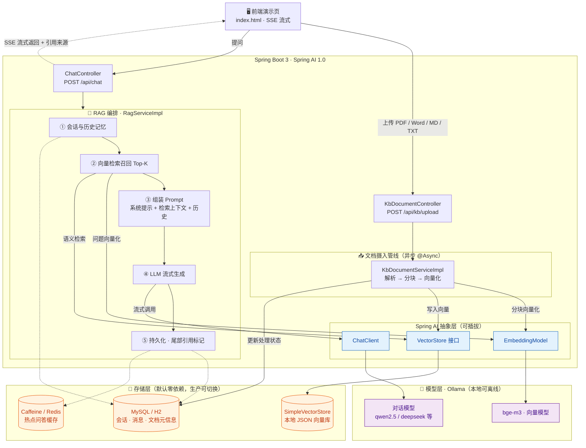

# 🧠 AI 智能知识库问答平台（AI Knowledge Base Q&A Platform）

> 一个基于 **RAG（Retrieval-Augmented Generation，检索增强生成）** 架构的企业级智能问答后端系统。
> 使用 **Java + Spring Boot 3 + Spring AI** 构建，融合大语言模型（LLM）与向量检索，为用户提供**基于私有知识库的精准、可溯源问答服务**。

<p align="center">
  
  
  
  
  
  
  
  
</p>

---

## 📌 项目背景与价值

传统大语言模型（LLM）存在两大痛点：
1. **知识截止**：训练数据有时间限制，无法回答最新或私域知识。
2. **幻觉问题**：对不确定的内容"一本正经地胡说八道"。

本项目通过 **RAG 架构** 解决上述问题：在用户提问时，先从企业私有知识库中**检索**出相关文档片段，再将这些片段作为**上下文**交给 LLM **生成**回答，并**给出引用来源**。既保证了答案的准确性，又实现了可溯源、可解释。

## ✨ 核心特性

| 模块 | 说明 |
| --- | --- |
| 📄 文档摄入管线 | 支持 PDF / Word / Markdown / TXT 上传，异步解析 → 清洗 → 分块（Chunking）→ 向量化 → 写入向量库 |
| 🔍 混合检索 | 向量语义检索 + 关键词检索，配合**重排序（Rerank）**提升召回质量 |
| 💬 流式对话 | 基于 **SSE（Server-Sent Events）** 实现打字机式流式输出，低延迟体验 |
| 🧵 多轮会话记忆 | 基于会话窗口 + Redis 维护多轮上下文，支持追问 |
| 🔗 答案溯源 | 回答附带引用文档片段与页码，可点击跳转原文 |
| ⚡ 高性能 | 异步非阻塞处理、Redis 缓存热点问答、接口幂等设计 |

## 🏗️ 系统架构



**一次问答的完整时序：**
1. 用户提问 → `ChatController`（以 SSE 流式通道返回）
2. `RagServiceImpl` 加载会话历史记忆（最近 N 条）
3. 问题经 `EmbeddingModel` 向量化 → `VectorStore` 检索 Top-K 相关片段
4. 组装 Prompt（RAG 系统提示 + 检索上下文 + 历史 + 当前问题）
5. `ChatClient` 调用 LLM 流式生成，逐字经 SSE 推送前端
6. 持久化会话消息，尾部附带**引用来源标记**，并写入热点问答缓存

## 🛠️ 技术栈

- **语言/框架**：Java 17、Spring Boot 3.4、Spring MVC
- **AI 框架**：Spring AI 1.0（ChatClient / EmbeddingModel / VectorStore）
- **模型**：本地 **Ollama**（对话 qwen2.5 + 向量 bge-m3），可插拔切换 OpenAI / DeepSeek / 通义千问
- **数据层**：MyBatis-Plus、MySQL 8、Redis
- **向量检索**：PostgreSQL + pgVector（或 Qdrant / Milvus）
- **异步与通信**：Spring `@Async`、线程池、SSE
- **工程化**：Maven、Docker、SpringDoc (OpenAPI)

## 🚀 快速开始

```bash
# 1. 克隆项目
git clone <your-repo-url>

# 2. 启动本地模型服务 Ollama（需先安装 Ollama：https://ollama.com）
#    拉取对话模型 + 向量模型
ollama pull qwen2.5:7b          # 对话模型
ollama pull bge-m3                # 向量模型（1024 维，中文 RAG 推荐）
ollama serve                    # 启动，默认监听 http://localhost:11434

# 3. 启动基础依赖（MySQL / Redis / pgVector，可用 docker-compose 一键拉起）
docker-compose up -d

# 4. 运行
mvn spring-boot:run

# 访问：http://localhost:8080/index.html 即可在演示页体验问答
```

> 💡 **模型可插拔**：本项目默认对接本地 Ollama（零成本、可离线演示）。如需切换为云端模型
> （OpenAI / DeepSeek / 通义千问 DashScope），只需在 `application.yml` 中切换对应配置段，
> 并保证向量维度与 embedding 模型一致即可，业务代码无需改动。

## 📖 文档

- [架构设计详解](docs/架构设计.md)
- [简历亮点与面试话术](docs/简历亮点.md)
- [API 接口说明](docs/API说明.md)

## 🎯 为什么这个项目"有含金量"

- **前沿性**：RAG / 向量检索 / Embedding 是当下 AI 应用落地的核心技术
- **深度**：涉及异步、流式、缓存、幂等等后端进阶议题，不是 CRUD
- **可讲性**：有架构、有难点、有优化指标，面试可深挖
- **可扩展**：可继续演进为多知识库、多租户、Agent 工具调用等
